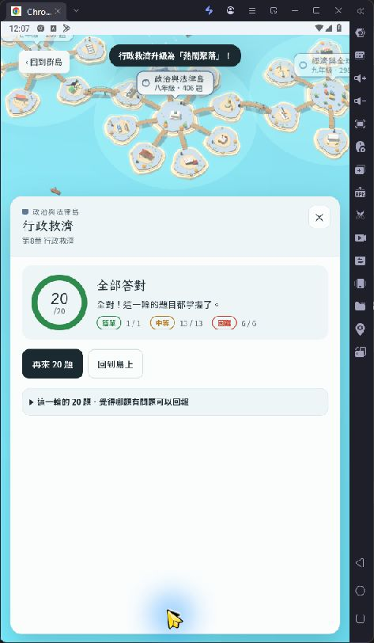
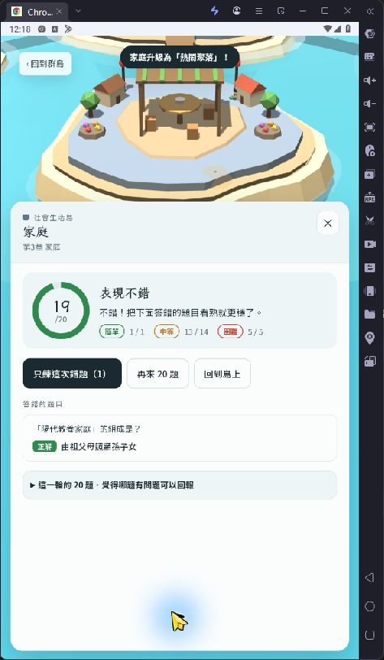
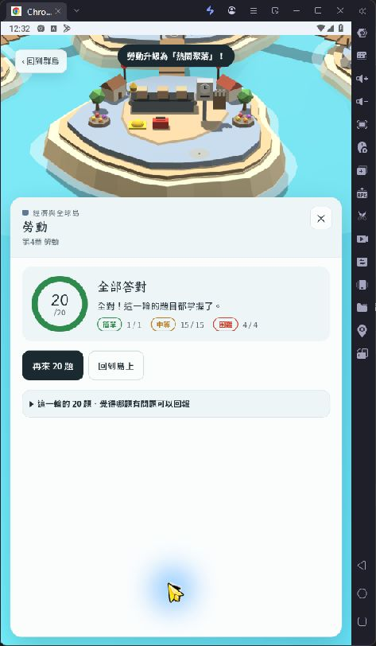

# Android模擬器實際操作驗收（2026-10-29）

題庫對照來源：`44f82be3d925c5bb45edcbf52f03d553b474ec5c`；測試開始及整理時GitHub主分支：`80120134b4ecd902e1000c43d4cdbe0475f0d8dc`。本次只更新review驗收文件及證據，未修改題庫或程式。

**已完成Android模擬器三輪各20題，加1題錯題重練，共61次提交、60個唯一題號。三輪的兩項選項重複指標均0；計分、中斷後重啟續答、A–D原序、進度保存及錯題清除通過。模擬器圖表尚未測完，視窗啟用失敗待排除。這次是Android模擬器實際操作，仍不是實體手機驗證。**

## 環境與方法

- 雷電模擬器9，啟動畫面曾顯示9.5.19.0。Android與Chrome實際版本未讀取。
- 使用者先在模擬器的Chrome開啟正式網站，之後從Android桌面「社會科複習島」捷徑啟動直向網頁。
- 初期瀏覽器橫向首頁載入可見；主要作答為直向。典型擷取影像473×812，包含模擬器外框；這不是讀取到的Android解析度或CSS viewport值。
- 全程用原生Windows Computer Use點擊、拖曳操作模擬器，逐張閱讀題幹及四個選項順序，與固定離線題庫以唯一文字片段對照。未使用Android DOM、ADB、隱藏遊戲狀態或注入答案。
- 兩項指標按實際呈現順序計算：後題四選項是否包含前題正解；是否與任一前題共用至少兩個完整選項文字。原始截圖保留；文字辨識不唯一時先停止核對後才選答。

模擬器可見3,840題，並實際出現soc3-g20、g22、g24、g28、g30新版家庭功能誘答，與對照來源一致。未從模擬器讀取script雜湊，因此不能宣稱Android載入內容已做位元層級的部署同一性驗證；第五輪的來源／正式桌面頁雜湊證據另外保留。

## 三輪選答、計分與選項輪替

| 章節 | 提交／分數 | 前題正解出現在後題選項 | 與前題共用至少2選項 |
|---|---|---|---|
| law8 | 20題／20／20 | 0 | 0 |
| soc3 | 20題／19／20 | 0 | 0 |
| eco4 | 20題／20／20 | 0 | 0 |

家庭輪次第一題故意選「子女白天由保母照顧」，系統判錯並標出「由祖父母照顧孫子女」；其餘19題答對，結算19/20。這是錯誤路徑測試，不是題庫正解有誤。每輪的題數、每題選答回饋及最終分數都互相吻合。

[61次選答、順序及回饋核對](evidence/android_emulator_2026-10-29/browser-rounds.json)、[三輪重複統計](evidence/android_emulator_2026-10-29/overlap-metrics.json)、[離線核驗](evidence/android_emulator_2026-10-29/native-audit.json)。樣本為零不等於所有隨機輪次都必然為零；前輪34,800組離線配對模擬仍作為另一類證據。

## 中斷、重啟及保存

行政救濟前10題答對後，在第11題尚未作答時，從Android最近使用畫面關閉社會科複習島工作卡片，再由桌面捷徑重啟。網站提示「第11/20題中斷，答對10題」，續答後仍是law8-g17，選項完整保留A陳情、B行政訴訟、C罷免、D彈劾，最後完成20/20。先前嘗試Ctrl+R未產生可確認的重新載入，未把那次嘗試當作刷新成功；通過項目是關閉工作卡片後重啟續答。

[重啟前](evidence/android_emulator_2026-10-29/r1-q11-before-reload.png)、[續答提示](evidence/android_emulator_2026-10-29/r1-resume-prompt.png)、[重啟後同題原序](evidence/android_emulator_2026-10-29/r1-q11-after-reopen.png)、[對照紀錄](evidence/android_emulator_2026-10-29/resume.json)。

前兩輪完成後，39題處於答對狀態、1題待訂正。再次關閉工作卡片並重啟，39題及1題錯題仍在。從錯題島重練soc3-g6，答對後結算1/1，錯題島變為0題；網站備份面板顯示40筆作答紀錄，符合前兩輪40個唯一題號。

[重啟前進度](evidence/android_emulator_2026-10-29/22-home-progress.png)、[重啟後](evidence/android_emulator_2026-10-29/30-home-progress-after-reopen.png)、[錯題島1題](evidence/android_emulator_2026-10-29/31-wrong-island.png)、[重練1/1](evidence/android_emulator_2026-10-29/retry-result.png)、[清為0題](evidence/android_emulator_2026-10-29/32-wrong-cleared.png)、[備份面板40筆](evidence/android_emulator_2026-10-29/35-progress-backup-summary.png)、[保存核對](evidence/android_emulator_2026-10-29/progress.json)。這只驗證該模擬器資料，不能代替每位既有學生裝置的升級驗證。

## 成功、失敗、未測試

| 類別 | 結果 |
|---|---|
| 成功 | Android直向網站載入、章節切換、滑動列表、三輪60題、正誤回饋及計分、重啟同題A–D原序續答、進度與錯題保存、錯題島重練清除、備份面板筆數核對 |
| 自動化／環境失敗 | 欲輸入「冬季雨量特別多」，搜尋欄收到舊的網站網址，圖表查找未完成；文字頁輔助程式的Computer Use app approval timed out，未取得其控制權且未繞過。其後模擬器視窗兩次回報failed to activate captured window，重新選取視窗後仍失敗 |
| 待釐清 | 大字模式小按鈕的短點擊切換不穩；小幅拖曳後確認還原。無法據此區分輸入注入與網站問題，未列為確證題庫程式缺陷 |
| 本輪未測試 | Android模擬器圖表渲染、完整搜尋文字輸入、模擬器瀏覽器console、Android script雜湊、橫向完整作答、實體手機、真實觸控硬體、手機GPU、Safari/iOS |
| 尚待收尾 | 每輪題數目前仍20，視窗恢復後應還原10；大字模式已還原。需將模擬器帶回網站畫面，以補圖表與設定還原 |

[輸入實際結果](evidence/android_emulator_2026-10-29/48-climate-search-input.png)、[環境及限制](evidence/android_emulator_2026-10-29/environment.json)。28筆圖表來源沒有更動；第五輪桌面瀏覽器的氣候圖、第四輪三類圖表證據仍保留，不能轉稱Android模擬器已測。

## 文件、覆蓋與交付

本次沒有新增題目內容審查：沿用第五輪可追溯的1,874題內容通過紀錄，另1,966題內容未複審。模擬器本輪60個唯一ID另設欄位，與桌面窄畫面及內容審查分開。[3,840題完整覆蓋清單](acceptance_coverage_2026-10-27.md)。

GitHub保留逐題文字紀錄及關鍵畫面；完整129張逐題截圖收在本次交付ZIP的raw/frames，檔名及SHA256見[完整截圖清單](evidence/android_emulator_2026-10-29/raw-screenshots-manifest.json)。未收入Android桌面遊戲清單、無關桌布等畫面。

[第五輪當時驗收快照](final_acceptance_2026-10-29_round5_historical.md)、[最新驗收追蹤](final_acceptance_2026-10-27.md)。
