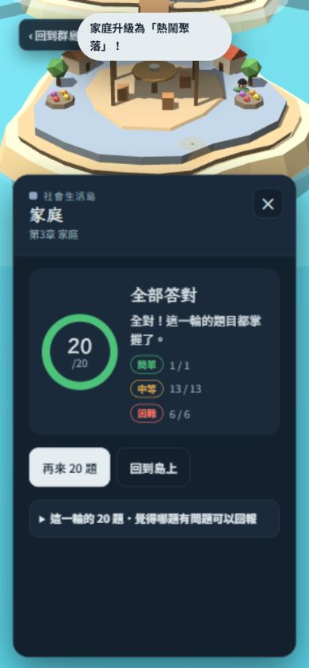

# 第四輪題庫與抽題驗收（2026-10-29）

固定題庫來源：`e743ac12233a48fd68a3b6ba8147216d4be3c761`；比較基準：`7ee6394c5ee2ef9b353c387eff0099abb3758028`。此輪只更新review文件與證據，沒有修改題庫或網站程式。

**71個實際更動ID全數複審：70題通過、1題可選消歧、0題確證需修。上輪12項均結案。六章正式網頁各20題，共120題，兩項選項輪替指標均為0；刷新後A–D原序續答通過。實體手機仍未測試，不能宣稱完成手機或全3,840題內容最終驗收。**

## 範圍與版本

| 項目 | 結果 |
|---|---|
| 全題庫結構 | 3,840唯一ID，與上輪集合相同；無新增／刪除，正解及題幹未改 |
| 真實更動 | 71題誘答、其中59題解析；待審59題＋上輪12題，無清單外遺漏 |
| 逐題內容 | 閱讀全部71題題幹、正解、三誘答、完整解析及4個非空情境 |
| 引擎／匯出 | 實際執行離線引擎，與questions.json十欄逐題0差異 |
| 建置 | 隔離副本執行既有build.py成功；index、sw、manifest統一換行後均相符 |
| 正式頁版本 | DOM中5個script逐一雜湊與來源相符；不以主頁能開啟就假定最新版 |
| 部署 | [Pages run 40806464178](https://github.com/lutm6666/social-studies-review-island/actions/runs/40806464178)同來源SHA成功 |

[71題改前／改後與判語](evidence/round4_2026-10-29/content-review.json)、[結構及差異](evidence/round4_2026-10-29/source-audit.json)、[來源Git雜湊](evidence/round4_2026-10-29/source-provenance.json)。

## 上輪12項複驗

| 題號 | 結果 |
|---|---|
| `qpe-h49` | 通過；已核對上輪指出的改動；新版誘答與正解互異，原問題複驗通過。 |
| `jsc-h40` | 通過；已核對上輪指出的改動；新版誘答與正解互異，原問題複驗通過。 |
| `cnh2-h10` | 通過；已核對上輪指出的改動；新版誘答與正解互異，原問題複驗通過。 |
| `cnh6-h2` | 通過；已核對上輪指出的改動；新版誘答與正解互異，原問題複驗通過。 |
| `wdh6-h4` | 通過；已核對上輪指出的改動；新版誘答與正解互異，原問題複驗通過。 |
| `wdh6-h7` | 通過；已核對上輪指出的改動；新版誘答與正解互異，原問題複驗通過。 |
| `twg5-h5` | 通過；已核對上輪指出的改動；新版誘答與正解互異，原問題複驗通過。 |
| `law2-g46` | 通過；誘答已補「超過判決指定失效日」；不再把定期失效前仍有效的情況一概判錯。依憲法訴訟法第52、54條，原問題修正通過。 |
| `eco1-h7` | 通過；已核對上輪指出的改動；新版誘答與正解互異，原問題複驗通過。 |
| `eco1-h9` | 通過；已核對上輪指出的改動；新版誘答與正解互異，原問題複驗通過。 |
| `eco1-g40` | 通過；誘答已改為「不需取捨就能同時推動所有公共建設」，可與有限預算須取捨明確區分，原品質建議結案。 |
| `eco2-h2` | 通過；已核對上輪指出的改動；新版誘答與正解互異，原問題複驗通過。 |

law2-g46的誘答已改為「超過判決指定失效日，該法律仍繼續有效」，原來定期失效前仍有效的歧義已排除。此判斷依[憲法訴訟法第52、54條](https://law.moj.gov.tw/LawClass/LawAll.aspx?pcode=A0030159)及[憲法法庭說明](https://cons.judicial.gov.tw/docdata.aspx?fid=21)；正式頁故意選該誘答會判錯，二題輪次得1/2，錯題島重練得1/1且清除。

## 新59題與一項可選建議

58題通過；soc3-g0留可選消歧，並非確證必修錯誤。

| 題號 | 問題 | 建議修改 |
|---|---|---|
| soc3-g0 | 新誘答「父母再婚後與雙方子女同住」用婚姻歷程區分家庭；核心家庭的正解卻只描述父母與未婚子女的成員結構。兩種判準可能交疊。國中教學通常將繼親／重組家庭另列，因此不直接判成第二正解。 | 可換成「只有未婚兄弟姊妹同住，沒有父母同住」，使成員結構明確不同。 |

[永吉國中家庭教育教案](https://www.yjjh.tp.edu.tw/wp-content/uploads/doc/yjjhoaacom01/%E6%B0%B8%E5%90%89%E5%9C%8B%E4%B8%AD_%E6%95%99%E6%A1%88%E7%94%84%E9%81%B8_v3.pdf)的檢索摘錄將核心與繼親家庭另列；[主計總處113年家庭收支調查](https://ws.dgbas.gov.tw/001/Upload/466/relfile/11503/235296/113.pdf)則以父母及未婚子女等同住結構定義核心家庭。交疊是本審查的推論，不冒充上述來源明文裁定本題錯誤。教案PDF全文開啟受檔案大小限制，本輪僅核對檢索摘錄，未宣稱讀完全本。

童工題eco4-g10的十五歲以上未滿十六歲符合[勞基法第44條](https://laws.mol.gov.tw/FLAW/PrintFLAWDOC01.aspx?flno=44&id=FL014930)。其餘新誘答未見明確第二正解。

## 正式網頁實際操作

環境為IAB桌面瀏覽器390×844窄畫面，使用可見按鈕逐題作答；DOM只讀題目、選項、SVG及script文字，未注入答案或讀取隱藏遊戲狀態。

| 章節 | 題數／分數 | 後題選項含前題正解 | 與前題共用至少2選項 |
|---|---|---|---|
| law8 | 20／20 | 0 | 0 |
| law2 | 20／20 | 0 | 0 |
| eco4 | 20／20 | 0 | 0 |
| eco5 | 20／20 | 0 | 0 |
| eco2 | 20／20 | 0 | 0 |
| soc3 | 20／20 | 0 | 0 |

刷新測試在行政救濟完成10題後、顯示第11題law8-g12時進行：續答提示10/20、同題、同四選項及A–D完整原序均保留，並完成20/20。上輪保留的換序失敗紀錄不被改寫，本輪新證據證明修正成功。

另測law2-g46/g47二題、錯題重練一題，以及5個圖表題。此輪共128次實際提交、126個唯一題號。六輪0重複是實際樣本結果，不是所有隨機結果的數學保證。

[六輪完整操作文字](evidence/round4_2026-10-29/browser-rounds.json)、[輪替逐輪指標](evidence/round4_2026-10-29/overlap-metrics.json)、[刷新前後](evidence/round4_2026-10-29/resume.json)、[錯題保存／重練](evidence/round4_2026-10-29/wrong-retry.json)。

## 圖表與進度

28筆圖表資料（20氣候、5人口金字塔、3產業堆疊圖）與上輪逐筆相同。本輪正式頁實際渲染及作答5題：twg3-h9、twg4-h8/h9/h10、twg5-h8，涵蓋三種圖表，SVG均有284×177.5的可見尺寸。人口圖同題幹選項的三題，另比對可見SVG與來源資料後才辨識題號，三題均答對。未宣稱本輪逐一看完全部28張。

進度鍵及3,840個ID不變；同一測試瀏覽器載入上輪80題紀錄，續答與錯題刷新保存均成功。這不能證明每位既有學生裝置都已完成升級。結束時錯題已清、每輪題數還原10、暫時窄畫面設定已還原。瀏覽器error/warn紀錄0筆。

[圖表核對](evidence/round4_2026-10-29/figure-verification.json)、[進度證據](evidence/round4_2026-10-29/progress-verification.json)、[測試環境及辨識限制](evidence/round4_2026-10-29/environment.json)。

## 離線抽題回歸

使用原始draw函式（本次函式本身未改），比較上輪與本輪題池；相同確定性種子，58章×300輪×全新／混合進度兩種狀態＝34,800組配對20題輪次。前版平均每輪0.12658題包含前題正解、0.15948題共用至少2選項；本版兩項皆0，34,800輪皆0。六個邊界案例通過，未重複抽同一ID，未修改題庫或進度。這是離線自動化，與前述網站實際操作分列。

[模擬摘要](evidence/round4_2026-10-29/draw-simulation-summary.json)、[全部種子及結果gzip](evidence/round4_2026-10-29/draw-simulation-raw.json.gz)。

## 成功、失敗、未測試

| 分類 | 結果 |
|---|---|
| 成功 | 本輪71題全數複審；上輪12項結案；3,840結構及匯出一致；正式六輪、計分、錯題刷新保存及重練、A–D原序續答、三類圖表抽樣、34,800配對模擬通過 |
| 失敗 | 本輪沒有已確證的功能失敗或必修題；soc3-g0是1項可選消歧。測試辨識曾因同題幹人口圖不唯一而停止，已依可見SVG補辨識完成，未冒稱首次自動化全程無誤 |
| 未測試 | 實體手機、Android模擬器、Safari／iOS、真實觸控與手機GPU、所有學生裝置升級、全部28圖的本輪逐張渲染、全部3,840題內容重新逐題讀審 |

累計有可追溯內容審查的1868題：1867通過、1可選消歧、0需修；其餘1972題標「內容未複審」。舊題僅在十欄完全相同時沿用舊審查，不把結構正常算成內容已審。[3,840題完整覆蓋清單](acceptance_coverage_2026-10-27.md)。

[第三輪歷史報告](https://github.com/lutm6666/social-studies-review-island/blob/80e9000d63a2684bae95d468116311dcf406cd33/review/findings_round3_2026-10-29.md)及[當時驗收快照](final_acceptance_2026-10-29_round3_historical.md)保留舊結論；目前狀態以本輪及[最新驗收](final_acceptance_2026-10-27.md)為準。
