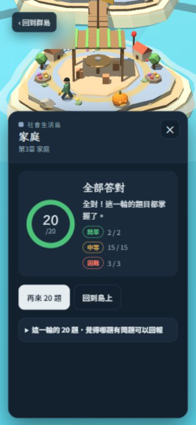

# 第五輪題庫與網站複審（2026-10-29）

固定題庫來源：`44f82be3d925c5bb45edcbf52f03d553b474ec5c`；上輪來源：`e743ac12233a48fd68a3b6ba8147216d4be3c761`（報告提交`740b0c21f2cf14b3c778ce056b59637734fc5715`）。

**8個實際更動ID全部通過，0需修、0新增可選題目建議；上輪soc3-g0結案。家庭章節正式網站三輪各20題全對，8題更動全數在畫面出現並實際作答；同輪兩項選項輪替指標均0。另同步待審清單2處舊文字，未修改題庫或網站程式。手機實機及全題庫內容最終驗收仍未完成。**

## 一、差異與來源核對

| 核對項目 | 結果 |
|---|---|
| 真實更動 | 8題誘答、其中6題解析；題幹／正解／題號不變，無新增刪除 |
| 清單口徑 | pending_small_term_foils共65個唯一ID；本輪8題更動、57題與上輪完全相同，不能誤稱本輪新改65題 |
| 本輪閱讀 | 全8題改前及改後的題幹、正解、三誘答、解析；6篇更動解析全讀；無非空情境 |
| 全題庫結構 | 3,840唯一ID；四選項互異且非空，題幹解析非空；引擎執行後與questions.json十欄逐題0差異 |
| 來源驗證 | 36份實際使用來源blob與當前Git樹SHA-1全部相同；含沿用但未改的來源檔 |
| 建置 | 隔離副本執行既有build.py；index、sw、manifest統一換行後全部相符 |
| 正式頁 | DOM中5個script逐一雜湊與本輪來源相符；不以網站能載入推定版本 |
| 部署 | [Pages run 40809933461](https://github.com/lutm6666/social-studies-review-island/actions/runs/40809933461)同SHA成功 |

[差異與結構](evidence/round5_2026-10-29/source-audit.json)、[8題完整改前／改後](evidence/round5_2026-10-29/content-review.json)、[來源驗證](evidence/round5_2026-10-29/source-provenance.json)。

## 二、逐題結果

| 題號 | 問題／判斷 | 建議修改 |
|---|---|---|
| `soc3-g0` | 通過。已移除以再婚歷程排除核心家庭的誘答，改成只有兄弟姊妹且沒有父母同住的成員結構；上輪可選消歧複驗通過。 | 無需修改 |
| `soc3-g4` | 通過。長期派駐國外與住校描述居住安排，並不是只有父或母一方的組成定義；不再與g0重複使用未婚手足同住的誘答。未見新增第二正解。 | 無需修改 |
| `soc3-g20` | 通過。生育子女本身是家庭生育功能；補助、產檢與學校性平教育是其他機構的措施，並非題目要辨識的家庭本身行為。 | 無需修改 |
| `soc3-g22` | 通過。生活規範與價值觀的家庭教導符合教育功能；補習班課業、政府政策、圖書館活動的提供者不同。依家庭章節與解析的範圍判斷，未見明確第二正解。 | 無需修改 |
| `soc3-g24` | 通過。家庭成員分擔生活支出符合家庭經濟功能；貸款、政府補助與公司薪資是外部金融／政府／企業的行為。家庭可受益，不等於由家庭直接提供該措施。 | 無需修改 |
| `soc3-g26` | 通過。家人相互支持符合家庭情感功能；學校諮商、網友留言、社區活動可以提供外部支持，但不是題目限定的家人互動。 | 無需修改 |
| `soc3-g28` | 通過。家人照顧幼老病者符合家庭保護功能；警察、醫院與長照機構的服務可以分擔照顧，不能因此視為本題要求的家庭本身行為。解析沒有宣稱家庭不得求助外部機構。 | 無需修改 |
| `soc3-g30` | 通過。依家庭章節判準，一起出遊共享休閒指家人活動；其他三項明示公司、學校、社區辦理，未見明確第二正解。 | 無需修改 |

六題家庭功能以「家庭」章節及解析中的「家庭本身」為判準。外部機構可能支持家庭、分擔部分功能，不等於該機構措施就是家人直接執行的行為；本輪沒有把「家庭不可使用醫院／補助」這類錯誤推論加進解析。政府、醫院等新選項依此範圍可排除，正解可辨。

參照[衛福部家庭功能評估說明](https://www.mohw.gov.tw/dl-87685-1b10b921-40f2-4d47-af2f-c04eff14af52.html)及[學校家庭生活教材](https://www.stgvs.ntpc.edu.tw/uploads/1710916078013NLQd4CBm.pdf)的檢索摘錄，家庭功能涉及成員間的照顧、情感、經濟、教育及休閒。外部來源直接開啟／截圖部分遭逾時或快取限制，本輪未宣稱讀完PDF；主要判斷仍逐題對照實際題庫與可見的家庭章節範圍。

## 三、待審文件同步

固定來源的pending_small_term_foils.md第14、22行仍是前版文字，與當前題庫不一致。本次只將這兩處review文件同步為既有實際選項：

| 題號 | 清單原文字 | 同步後文字（題庫原已如此） |
|---|---|---|
| soc3-g0 | 父母再婚後與雙方子女同住 | 只有未婚兄弟姊妹同住，沒有父母同住 |
| soc3-g4 | 未婚的兄弟姊妹一起生活 | 父母長期派駐國外、子女住校 |

同步後65項新誘答全部與questions.json一致；未碰src、index、sw或questions.json。來源清單兩處不一致屬文件檢查失敗，已在本輪修正，不能算題庫內容錯誤。[原始差異](evidence/round5_2026-10-29/pending-consistency.json)、[同步前後雜湊與複驗](evidence/round5_2026-10-29/pending-sync.json)、[同步後清單](pending_small_term_foils.md)。

## 四、正式網站操作

環境：IAB桌面瀏覽器390×844窄畫面。以可見按鈕作答；DOM只讀題目、選項、SVG和script文字，未注入答案或讀取隱藏遊戲狀態。

| 輪次 | 章節 | 分數 | 後題選項含前題正解 | 與前題共用至少2選項 |
|---|---|---|---|---|
| 1 | 家庭 soc3 | 20／20 | 0 | 0 |
| 2 | 家庭 soc3 | 20／20 | 0 | 0 |
| 3 | 家庭 soc3 | 20／20 | 0 | 0 |

三輪60次作答共36個唯一家庭題號，包含本輪所有8個更動ID。第一輪完成10題、顯示第11題時刷新：續答提示與10題正確紀錄保留，同題、同選項集合及A–D原序皆相同，繼續完成20/20。

另故意在soc3-g28選「醫院照顧住院病人」，頁面判錯並結算0/1；刷新後錯題島仍有1題，重練選家人照顧得1/1，錯題清除。氣候圖twg3-h9正式頁顯示SVG尺寸284×177.5、作答1/1。本輪共63次提交、37個唯一題號。

[三輪原始操作](evidence/round5_2026-10-29/browser-rounds.json)、[輪替逐輪統計](evidence/round5_2026-10-29/overlap-metrics.json)、[刷新續答](evidence/round5_2026-10-29/resume.json)、[錯題保存／重練](evidence/round5_2026-10-29/wrong-retry.json)、[氣候圖](evidence/round5_2026-10-29/figure.json)。

## 五、抽題、圖表及進度回歸

58章×每章300種子×全新／混合進度兩種狀態＝34,800組配對20題輪次。以相同種子比較上輪與本輪題池，原始draw函式未變；新版兩項精確字串重複指標均為0，上版同樣為0，未見退步。6個邊界案例通過，無重複ID，未修改進度或題庫。這是離線自動化，並非網站或手機操作；隨機抽樣為零也不是所有可能輪次的數學保證。[摘要](evidence/round5_2026-10-29/draw-simulation-summary.json)、[全部種子gzip](evidence/round5_2026-10-29/draw-simulation-raw.json.gz)。

28筆圖表資料與上輪完全相同（20氣候、5人口金字塔、3產業堆疊），本輪重看1題氣候圖；人口金字塔與堆疊圖的實際操作證據沿用[第四輪固定快照](https://github.com/lutm6666/social-studies-review-island/blob/740b0c21f2cf14b3c778ce056b59637734fc5715/review/evidence/round4_2026-10-29/figure-verification.json)，未冒稱本輪重看全部28張。

進度鍵及ID集合不變，app.js來源未變。測試瀏覽器載入上輪191題紀錄；刷新續答、錯題保存與清除通過，不能替代每位學生裝置的升級驗證。結束已還原每輪10題及暫時窄畫面設定。瀏覽器error/warn紀錄0筆。[進度核對](evidence/round5_2026-10-29/progress-verification.json)、[環境](evidence/round5_2026-10-29/environment.json)。

## 六、成功、失敗與未測試

| 類別 | 狀態 |
|---|---|
| 成功 | 8題全部通過；上輪soc3-g0結案；結構、引擎／匯出、建置及正式頁版本一致；三輪60題全對且0輪替；刷新原序、錯題保存／重練、氣候圖及34,800配對回歸通過 |
| 發現並已修正 | 待審清單2處舊文字；僅同步review文件，65項複驗一致 |
| 失敗／待修 | 本輪未發現確證的題庫內容錯誤或網站功能失敗；不把外部PDF讀取受限算成網站問題 |
| 未測試 | 實體手機、Android模擬器、Safari/iOS、真實觸控及手機GPU、所有既有學生裝置、全部28圖本輪逐張顯示、全部3,840題知識內容重新讀審 |

累計1874題有可追溯內容審查且全數通過，其餘1966題明列「內容未複審」；舊題只有十欄完全相同才沿用審查。結構正常不能當作全部知識正確。[3,840題覆蓋清單](acceptance_coverage_2026-10-27.md)、[第四輪歷史快照](final_acceptance_2026-10-29_round4_historical.md)、[最新驗收](final_acceptance_2026-10-27.md)。
